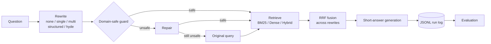

<div align="center">

# 🧬 rag-thesis

### Domain-Safe Query Rewriting for Biomedical RAG

*When does LLM query rewriting actually help retrieval, and how do we stop it from breaking gene names, mutations and negations?*


[Overview](#-overview) •
[Pipeline](#-pipeline) •
[Quickstart](#-quickstart) •
[Commands](#-commands) •
[Configuration](#%EF%B8%8F-configuration) •
[Testing](#-testing) •
[License](#-license)

</div>

---

## 📖 Overview

A reproducible **retrieval-augmented question-answering pipeline** for biomedical factoid questions.

LLMs are good at rephrasing a question, but in biomedicine one changed token can change the meaning. For example:

| Original | Bad rewrite | What broke |
|---|---|---|
| `BRAF V600E` | `BRAF mutation` | Specific mutation lost |
| `does not respond` | `responds` | Negation flipped |
| `p53` | `protein 53` | Gene name altered |

This project studies **when rewriting helps retrieval** and adds a **domain-safe guard**. The guard flags rewrites that drop critical tokens (gene names, codes, numbers, abbreviations), add new ones or add a negation, then either repairs the rewrite or falls back to the original query.

> [!NOTE]
> The current guard (the one the thesis used) catches the `p53` case above but misses the other two: it does not read `V600E` as a critical token and does not notice a negation that disappears. A stricter **guard v2** (`guard/checks.py`) catches all three; it is built and tested but not yet the default (see [Roadmap](#%EF%B8%8F-roadmap)).

## ✨ Highlights

| | Feature | Details |
|---|---|---|
| 🔎 | **Retrieval** | BM25, dense (MiniLM embeddings), and hybrid, fused with Reciprocal Rank Fusion (RRF) |
| ✍️ | **Query rewriting** | `none`, `single`, `multi` (4 styles fused with RRF), `structured` (rewrites + entities and constraints), `hyde` (hypothetical passage). Cached for exact replays, with optional weighted fusion and a confidence gate that rewrites only when retrieval looks unsure |
| 🛡️ | **Domain-safe guard** | Detects missing or added critical tokens and added negations, then repairs or falls back to the original query. Guard v2 (not yet default) also catches removed negations, mutation codes and answer-type drift |
| 🔀 | **LangGraph workflow** | rewrite → guard → retrieve → generate → log. Branches (skip or fall back from a rewrite, guard on/off, top-3 retry after no answer) are real graph edges |
| 🔐 | **Answer safety** | Hardened prompt treats the question and passages as untrusted data. Guardrails in code refuse unsafe or injected questions before any model call, and an answer must be a plain span of its passages |
| 📊 | **Evaluation** | **Retrieval** (local): Recall@k, Hit@k, MRR, nDCG@10 with bootstrap CIs and paired tests. **Answers**: exact match and token F1 (local), plus an **LLM judge** (API key) that rates each answer correct / partially correct / incorrect / unsupported and scores faithfulness and relevance; judge verdicts are cached, so reports replay without new calls. **Reports**: latency, token usage, guard actions, answer leaks. **Guardrails**: a red-team set checked locally; the attack run against the answer model needs an API key |
| 📴 | **Offline-first** | Tests, data prep, indexing and retrieval evaluation need no API key and no network |
| 🎯 | **Deterministic** | Content-hash IDs, fixed seeds, `temperature=0`, stable tie-breaking |

## 🔄 Pipeline



**In short:** each question is rewritten, and the guard checks every rewrite. Safe rewrites go to retrieval, unsafe ones are repaired, and if repair fails the original query is used. Results from all rewrites are fused with RRF, a short answer is generated, and every step is logged as schema-validated JSONL for evaluation.

## 🚀 Quickstart

> **Requires Python 3.11+**

### 1. Install and test

```bash
python -m venv .venv

# Windows
.venv\Scripts\activate
# Linux / macOS
source .venv/bin/activate

pip install -r requirements.txt
pip install -e . --no-deps
pytest -q
```

### 2. Prepare data and run retrieval (offline)

> [!NOTE]
> The dataset is **not included**. See [data/README.md](data/README.md) for how to get and prepare it.

```bash
rag-thesis build-corpus --in data/raw/bioasq_subset.json
rag-thesis build-index --bm25
rag-thesis build-index --dense
rag-thesis eval-retrieval            # offline, no API key needed
```

### 3. Enable LLM steps (optional)

LLM-dependent steps (`run`, `run-batch`, `judge`) need a provider key in `.env` (see `.env.example`).

> [!IMPORTANT]
> Real LLM calls are **off by default** and must be switched on explicitly:
> - `--generate` for `run` / `run-batch`
> - `--allow-llm-calls` for `judge`
>
> Without these flags nothing is sent to a provider; cached results are replayed.

<details>
<summary><b>▶ End-to-end run on the full corpus</b></summary>

<br/>

After building the full corpus and its indexes (section 3 of [data/README.md](data/README.md)), the same commands answer and judge the evaluation questions against it; only the paths change. Each run writes into its own folder:

```bash
RUN=outputs/full_corpus/hybrid_none

rag-thesis run-batch --retriever hybrid --rewrite none --guard off --generate \
    --chunks-path data/full/processed/chunks.jsonl \
    --bm25-dir indexes/full/bm25 --vector-dir indexes/full/chroma \
    --log-path $RUN/runs/run.jsonl

rag-thesis eval-answers --run-log-path $RUN/runs/run.jsonl --reports-dir $RUN/reports

rag-thesis judge --run-log-path $RUN/runs/run.jsonl --chunks-path data/full/processed/chunks.jsonl \
    --reports-dir $RUN/reports --allow-llm-calls

rag-thesis report --runs-dir $RUN/runs --reports-dir $RUN/reports
```

Change `--retriever` / `--rewrite` / `--guard` (and the folder name) for the other conditions.

> [!TIP]
> Leave out `--generate` and `--allow-llm-calls` to check the setup first; retrieval still runs.

</details>

## 🧰 Commands

| Command | Purpose | API key |
|---|---|:---:|
| `make-subset` | Deterministic stratified QA subset | ❌ |
| `build-corpus` | Documents, chunks, questions, gold evidence | ❌ |
| `validate` | Schema-validate all JSONL artifacts | ❌ |
| `build-index` | BM25 and dense indexes | ❌ |
| `eval-retrieval` | Retrieval-only metrics (`--queries-from-log` replays a run's logged rewrites, e.g. on another corpus) | ❌ |
| `bench-retrieval` | Retrieval latency per retriever (index load, first query, mean / p50 / p95) | ❌ |
| `run` / `run-batch` | End-to-end RAG for one / many questions | ✅ * |
| `rewrite-batch` | Rewrite a question set into the rewrite cache (`--allow-llm-calls`), e.g. a dev split | ✅ * |
| `eval-answers` | EM / F1 from a saved run log | ❌ |
| `judge` | LLM-judge evaluation of a run log (`--allow-llm-calls`) | ✅ * |
| `report` | QA, latency, token-usage, guard and answer-leak reports | ❌ |

<sub>\* Not needed if every call is already cached.</sub>

All commands are run as `rag-thesis <command>` or `python -m rag_thesis <command>`. Add `--help` to any command to see its options.

## 🗂️ Project layout

```text
src/rag_thesis/
├── cli/            # command-line interface, one module per command
├── paths.py        # project-root resolution for default paths
├── config.py       # the one YAML config loader
├── schemas.py      # Pydantic models for every artifact
├── guardrails.py   # question / passage / answer safety checks
├── data/           # dataset loading, subsetting, corpus building, validation
├── retrieval/      # BM25, dense, hybrid (RRF), index building
├── rewrite/        # LLM query rewriting + cache
├── guard/          # domain-safe rewrite guard
├── llm/            # provider-agnostic LLM layer (Gemini, OpenAI-compatible, Anthropic)
├── prompts/        # versioned prompts for rewrite, repair, answer and judge
├── pipeline/       # LangGraph workflow, answer generation, batch runner
└── evaluation/     # retrieval, answer-quality, judge and report evaluation

tools/              # debugging and analysis scripts
tests/              # unit/ and integration/ tests (offline)
configs/            # YAML configuration
```

## ⚙️ Configuration

All settings live in **`configs/default.yaml`**. Every run stores a snapshot of its config next to its log.

| Area | What you can set |
|---|---|
| **Chunking** | Chunk size and overlap (default 180 / 40 MiniLM tokens) |
| **Retrieval** | Embedding model, retrieval depth, RRF constant |
| **Rewriting** | Optional confidence gate (`rewrite_gate_thresholds`); the rewrite mode itself is chosen per run with `--rewrite` |
| **Answer safety** | Answer prompt version (`answer_prompt_version`) and guardrails on/off (`guardrails`) |
| **LLM** | Per-role settings (`rewrite`, `repair`, `answer`, `judge`) in the `llm:` block |

<details>
<summary><b>▶ LLM providers, caching and guardrails</b></summary>

<br/>

**Switching provider or model is a config change only.** Define the provider under `llm.providers` and point a role at it. Supported:

- Gemini
- Any OpenAI-compatible server (OpenAI, Groq, Ollama, vLLM)
- Anthropic

The `llm/` layer provides a `ChatModel` interface, adapters, a registry, and retry / cache / offline-guard wrappers.

**Caching**
- LLM responses are cached at `llm.cache_path`, so repeated runs replay without API calls.
- Query embeddings are cached at `query_embedding_cache_dir`, so a replay reuses the exact vectors and never loads the embedding model.

**Answer safety**
- Answers use the hardened prompt `answer_v2` by default (`answer_prompt_version`). The question and retrieved passages are fenced as untrusted data, so instructions inside them are not followed, and out-of-scope or unsafe requests get `REFUSED`.
- Guardrails in code (`guardrails: true`, the default) don't rely on the model obeying: an injected or unsafe question is refused before any model call, and an answer must be a plain span of the passages it was generated from.

</details>

## 🧪 Testing

```bash
pytest -q
```

- ✅ Runs **fully offline**: LLM clients are mocked or replayed from cache
- ⏭️ Tests that need local data or indexes skip themselves
- 🤖 CI (`.github/workflows/ci.yml`) runs `ruff check`, `ruff format --check` and the tests on **Python 3.11 and 3.12** for every push and pull request, without secrets or data

## 🛣️ Roadmap

- [ ] Run the API-dependent experiments (weighted fusion, structured rewrites, HyDE, attacks on the answer model)
- [ ] Guard v2 (normalised, alias-aware checks), evaluated on human-labelled rewrites before it replaces the current guard

## 📄 License

This project's source code is released under the **[MIT License](LICENSE)**.

> [!NOTE]
> The license covers the code in this repository only. Datasets such as BioASQ are **not included** and stay under their own terms of use; obtain them from the original source and follow its license.